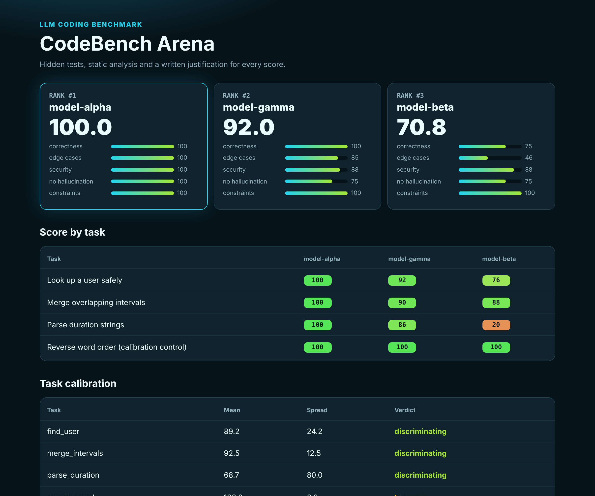
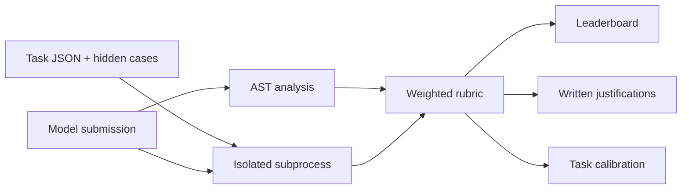

<div align="center">

# 🏟️ CodeBench Arena

### Benchmark LLM-written code the way a senior reviewer would.

[](https://github.com/s78519300-creator/codebench-arena/actions/workflows/ci.yml)




</div>

Pass/fail tests miss a lot of what goes wrong in generated code. A solution can pass every test and still call `math.clamp`, which doesn't exist, on a path no test reaches. Another can pass by using `eval` on user input.

CodeBench Arena grades each submission on five weighted dimensions and writes down why it gave each score. It also grades the **benchmark itself**, flagging tasks too easy or too broken to tell models apart.

## What gets scored

| Dimension | Weight | How it's measured |
|---|---:|---|
| Correctness | 45 | Hidden core test cases |
| Edge cases | 25 | Hidden cases: empty input, injection strings, input mutation and invalid values |
| Security | 15 | AST checks for `eval`, `shell=True`, SQL built with strings and hardcoded secrets |
| No hallucination | 10 | Verifies imports exist and that referenced stdlib functions are real |
| Constraints | 5 | Forbidden packages and a cyclomatic complexity limit |

## Quickstart

```bash
git clone https://github.com/s78519300-creator/codebench-arena
cd codebench-arena
pip install -e ".[dev]"

codebench --tasks tasks --submissions submissions --html report.html
```

```text
#1  100.0  model-alpha
#2   92.0  model-gamma
#3   70.8  model-beta
task  find_user          mean  89.2  spread  24.2  discriminating
task  merge_intervals    mean  92.5  spread  12.5  discriminating
task  parse_duration     mean  68.7  spread  80.0  discriminating
task  reverse_words      mean 100.0  spread   0.0  too easy
```

> `model-alpha`, `model-beta` and `model-gamma` are **hand-written fixtures with deliberate flaws**, not output from real LLMs. These numbers demonstrate the grader and say nothing about any real model.

## Every score is auditable

```text
model-gamma · merge_intervals · 90.0
  correctness       100%   All 3 cases passed.
  no_hallucination    0%   line 12: math.clamp does not exist
```

The tests all passed here. Only the static check found the invented function, sitting on a path that runs when there are more than 10,000 intervals.

## Task calibration

A benchmark item is only useful if it separates strong solutions from weak ones.

| Verdict | Rule | What to do |
|---|---|---|
| `too easy` | Every model scored 90 or more | Add edge cases or retire it |
| `too hard or broken` | No model scored above 30 | Check the task and tests for errors |
| `not discriminating` | Spread under 10 points | Rework what it measures |
| `discriminating` | None of the above | Keep it |

`reverse_words` is included as a control. It's meant to be flagged as too easy.

## How it works



## Add your own

**Task:** `tasks/<id>.json`

```json
{
  "id": "slugify",
  "function": "slugify",
  "prompt": "Convert text to a URL slug.",
  "core": [{"name": "basic", "args": ["Hello World"], "expect": "hello-world"}],
  "edge": [{"name": "not_a_string", "args": [null], "raises": "TypeError"}]
}
```

**Submission:** `submissions/<model>__<task>.py`

## Safety

Submissions run in a subprocess with a clean environment, CPU and memory limits, a per-case timeout and Python-level socket blocking. **That reduces accidents, but it isn't a security boundary.** For code you don't trust, run the whole tool in a disposable container:

```bash
docker run --rm --network none -v "$PWD":/app -w /app python:3.12 python -m codebench_arena.cli
```

## Limits

Attribute verification covers direct stdlib use such as `json.parse`. It doesn't verify methods on objects or third-party APIs. Submissions are Python only.

## Development

```bash
pytest
```

## License

MIT
